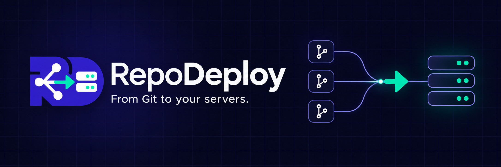
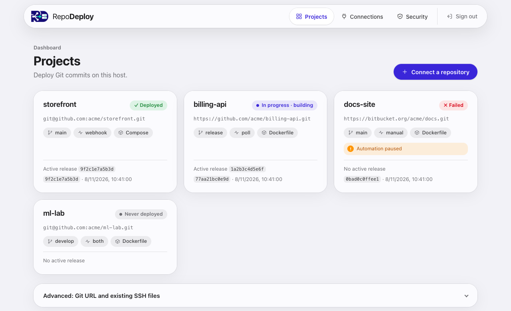
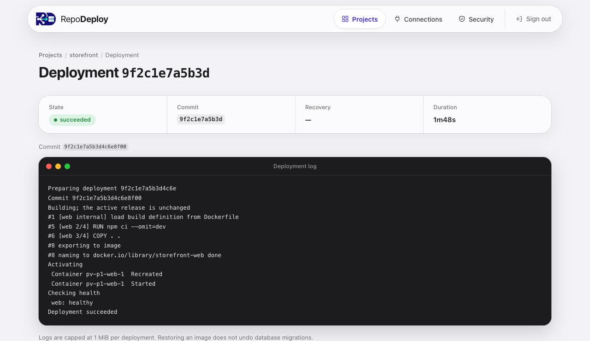
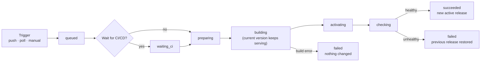
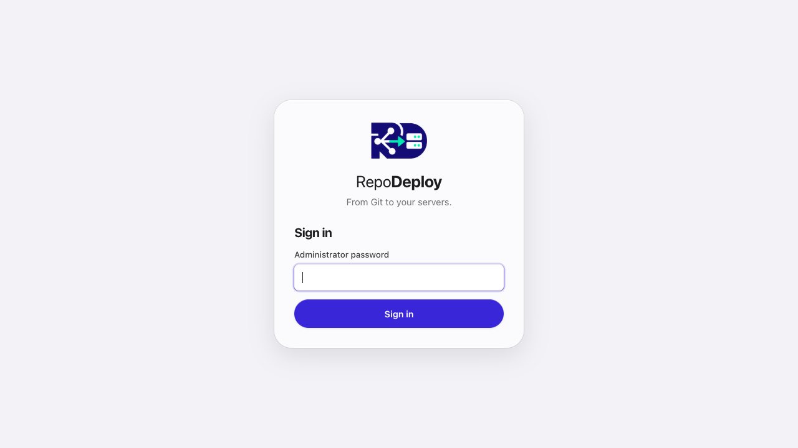
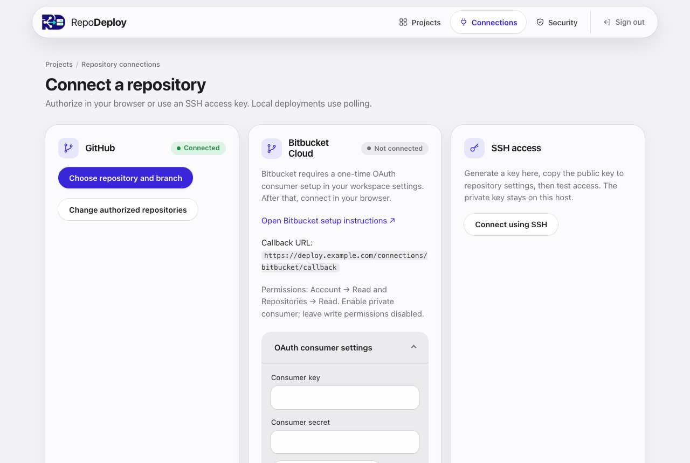
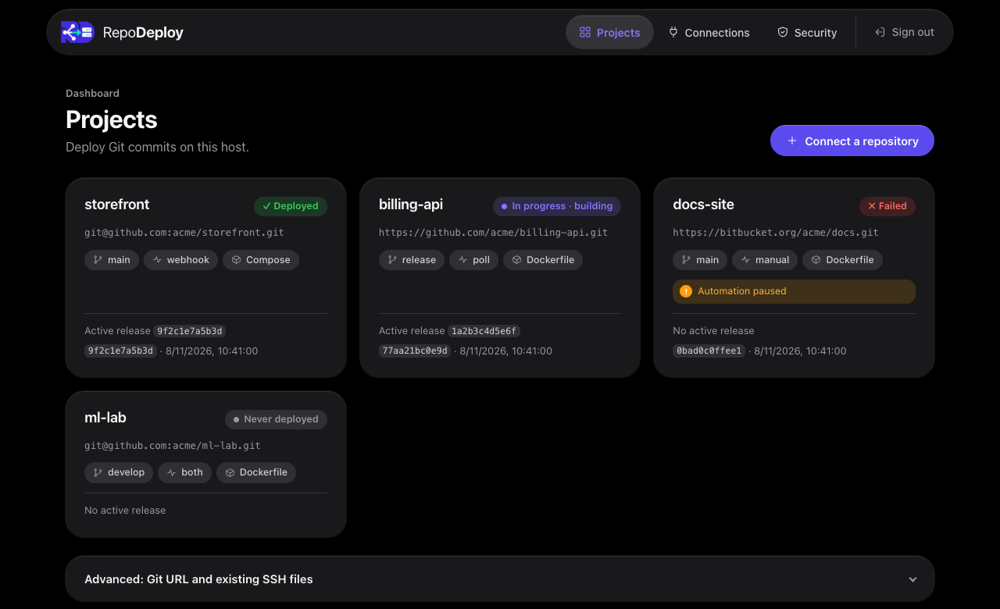
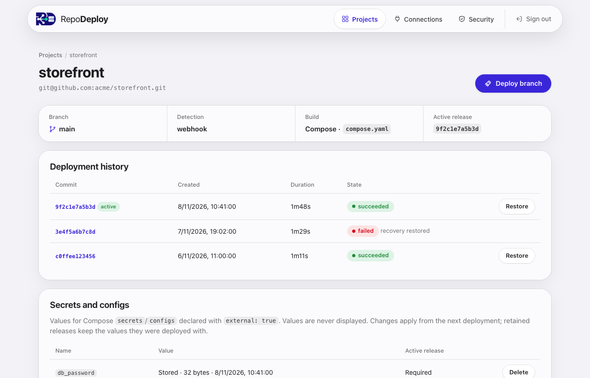

<p align="center">
  
</p>

<h3 align="center">Push to Git. Ship to your own server. No pipeline required.</h3>

<p align="center">
  <a href="#4-installation">Install</a> ·
  <a href="#5-first-run">First run</a> ·
  <a href="#13-cli-reference">CLI</a> ·
  <a href="#14-project-configuration-reference">Configuration</a> ·
  <a href="docs/installation.md">Docs</a>
</p>

**RepoDeploy turns any Linux box into your own deployment platform.** Connect a
GitHub, Bitbucket or SSH repository, pick a branch, and every push becomes a
safe, zero-drama release: RepoDeploy checks out that exact commit, builds it
with Docker or Docker Compose *while your current version keeps serving*,
health-checks the new one, and only then switches over. If anything fails, the
previous version is restored automatically and the log tells you why.

One static binary gives you the daemon, a polished web panel and a scriptable
CLI. No GitHub Actions minutes, no SaaS account, no hosted database, no
external registry: your code, your server, your rules.

- **Git-native:** signed GitHub webhooks, polling or one-click deploys, with
  optional waiting for your CI/CD checks.
- **Safe by default:** build-before-switch, health checks, automatic recovery
  and one-click rollback to any retained release.
- **Batteries included:** live streamed logs, Compose secrets management,
  browser sign-in for GitHub and Bitbucket, and a guided SSH key assistant.
- **Self-hosted and hardened:** strict CSP, throttled logins, sandboxed systemd
  unit and containers with `no-new-privileges`.

Network access is still needed to reach your repositories and pull base images.

> [!WARNING]
> **Status: early MVP.** Deploy only repositories you trust, on a host you
> administer. Access to Docker is root-equivalent on that host, and container
> hardening is defense in depth, not a sandbox for untrusted code.

<p align="center">
  
  
</p>

---

# User manual

The rest of this document is the complete guide: what RepoDeploy does, how to
install it, how to deploy your first application, and how to use every part
of the panel, the CLI and the API, with worked examples.

## Contents

1. [Concepts](#1-concepts)
2. [How a deployment works](#2-how-a-deployment-works)
3. [Requirements](#3-requirements)
4. [Installation](#4-installation)
5. [First run](#5-first-run)
6. [Tutorial: your first deployment](#6-tutorial-your-first-deployment)
7. [Preparing your repository](#7-preparing-your-repository)
8. [Connecting repositories](#8-connecting-repositories)
9. [Triggers: manual, polling, webhooks and CI/CD](#9-triggers-manual-polling-webhooks-and-cicd)
10. [Using the web panel](#10-using-the-web-panel)
11. [Releases, rollback and recovery](#11-releases-rollback-and-recovery)
12. [Secrets and configs](#12-secrets-and-configs)
13. [CLI reference](#13-cli-reference)
14. [Project configuration reference](#14-project-configuration-reference)
15. [HTTP API](#15-http-api)
16. [Running in production](#16-running-in-production)
17. [Security model](#17-security-model)
18. [Troubleshooting](#18-troubleshooting)
19. [Upgrading from earlier versions](#19-upgrading-from-earlier-versions)
20. [Development](#20-development)
21. [Scope and limitations](#21-scope-and-limitations)

## 1. Concepts

RepoDeploy uses a handful of terms everywhere: in the panel, the CLI and the
API.

| Term | Meaning |
| --- | --- |
| **Project** | One Git repository, one branch, and how to build, run and health-check it. |
| **Deployment** (job) | One attempt to ship one exact commit of a project. It has an ID, a phase, a log and a duration. |
| **Release** | A successful deployment. Its images and Compose manifest are retained, so it can be restored later without Git or a rebuild. A release ID is the ID of the deployment that produced it. |
| **Active release** | The release currently running for a project. |
| **Trigger** | What queues a deployment: the **Deploy** button or CLI (manual), polling, or a GitHub webhook. |
| **Worker** | A single queue that runs deployments one at a time, for all projects. The panel and the CLI share it. |
| **State directory** | `/var/lib/repodeploy`: database, credentials, secrets, release manifests and logs. |

## 2. How a deployment works



1. A webhook, a poll, or a manual request **queues** a deployment for the
   current head of the configured branch.
2. Optionally, RepoDeploy **waits for the commit's CI/CD checks** to pass.
3. The exact commit is checked out into an isolated release directory
   (**preparing**).
4. Images are **built** while the current version keeps serving traffic. If the
   build fails, nothing running is touched.
5. The new version is started (**activating**) and **health-checked**.
6. On success it becomes the active release and old releases beyond the
   retention limit are pruned. On failure the previous release is restored and
   the log explains why.

Every deployment ends as `succeeded` or `failed`. A failed deployment also
records what happened to the application:

| Recovery | Meaning |
| --- | --- |
| `restored` | The previous release was started again and passed its health check. |
| `removed` | This was the project's first deployment; its containers were removed. Volumes are kept. |
| `failed` | The previous release could not be restored. The project is **blocked** until you restore a release manually. |

> [!IMPORTANT]
> Activation can briefly interrupt traffic. Restoring containers **does not undo
> database migrations or writes**. A manual rollback pauses automatic
> deployments until you resume them.

## 3. Requirements

**Host running the daemon**
- Linux with systemd (amd64 or arm64).
- Docker Engine and Docker Compose v2.24 or newer.
- Git and the OpenSSH client.

**Building**
- Go 1.26 or newer. Release builds use Go 1.27.3; see
  [reproducible build](docs/installation.md#reproducible-build).

macOS and Windows daemons are not supported. The CLI also builds on macOS and
can manage a remote daemon.

Check the host before installing:

```sh
docker info --format '{{.ServerVersion}}'
docker compose version
git --version && ssh -V
```

## 4. Installation

### Option 1: install the daemon from source (recommended for servers)

On the Linux host:

```sh
git clone https://github.com/vicape92/repodeploy.git
cd repodeploy
go test ./...
CGO_ENABLED=0 go build -trimpath -buildvcs=false -o bin/repodeploy ./cmd/repodeploy
sudo sh scripts/install.sh bin/repodeploy
```

The installer:
- checks the prerequisites;
- creates the `repodeploy` system user and adds it to the `docker` group;
- creates `/var/lib/repodeploy` (mode `0700`);
- installs `/usr/local/bin/repodeploy` and the systemd unit.

It does not install system packages, change Docker's configuration, or start
the service.

To build on another machine, cross-compile with `GOOS=linux GOARCH=amd64` (or
`arm64`), then copy the binary to the host. The installer and the unit file
still come from a clone of this repository.

### Option 2: `go install`

```sh
go install github.com/vicape92/repodeploy/cmd/repodeploy@latest
```

This installs only the `repodeploy` binary, in `$(go env GOPATH)/bin`. Use it:

- **As a CLI on your workstation** (Linux or macOS), to manage a remote daemon.
  See [Using the CLI remotely](#using-the-cli-remotely).
- **As the daemon binary on a server.** Pass it to the installer from a clone of
  this repository: `sudo sh scripts/install.sh "$(go env GOPATH)/bin/repodeploy"`.

Pin a version with `@<commit>` or a tag instead of `@latest`.

## 5. First run

### Set the administrator password and start the service

Create a password file outside any repository, with mode `0600` and at least
12 characters. Initialize the credentials as the service user, then start the
daemon:

```sh
(umask 077 && openssl rand -base64 24 > ~/repodeploy-password)   # or write your own
sudo -u repodeploy /usr/local/bin/repodeploy init --password-file - < ~/repodeploy-password
sudo systemctl enable --now repodeploy
sudo journalctl -u repodeploy -n 50
```

`init` prints where the CLI token was stored:

```text
Administrator initialized. CLI token stored at /var/lib/repodeploy/admin.token
```

There is no default password, and `init` refuses to overwrite existing
credentials.

### Open the panel

The panel listens on `127.0.0.1:8081`. From your machine, open an SSH tunnel and
browse to <http://127.0.0.1:8081>:

```sh
ssh -L 8081:127.0.0.1:8081 your-server
```

<p align="center"></p>

To expose the panel or receive webhooks, put it behind an HTTPS reverse proxy;
see [Running in production](#16-running-in-production).

### Using the CLI remotely

The CLI only needs the daemon URL and the CLI token, which is stored in
`/var/lib/repodeploy/admin.token`.

**On the server, without `sudo`**, copy the token into your account once:

```sh
install -d -m 0700 ~/.config/repodeploy
sudo cat /var/lib/repodeploy/admin.token > ~/.config/repodeploy/token
chmod 600 ~/.config/repodeploy/token
repodeploy projects
```

**From a workstation:**

1. Copy the token into a private file, mode `0600`.
2. Open the SSH tunnel shown above.
3. Run the CLI against the tunnel:

   ```sh
   export REPODEPLOY_TOKEN_FILE=~/.repodeploy-token
   repodeploy projects            # uses http://127.0.0.1:8081 by default
   ```

Remote non-loopback URLs (`--url` or `REPODEPLOY_URL`) must use HTTPS.

The CLI looks for the token in this order:
1. `--token-file`;
2. `$REPODEPLOY_TOKEN_FILE`;
3. your configuration directory: `~/.config/repodeploy/token` on Linux,
   `~/Library/Application Support/repodeploy/token` on macOS;
4. `admin.token` in the state directory.

It refuses token files readable by group or others.

## 6. Tutorial: your first deployment

This walkthrough uses [`examples/app`](examples/app), a tiny BusyBox web server
with a Dockerfile, a Compose healthcheck, a persistent volume and switches to
simulate failures. In about ten minutes you will deploy it, ship a change,
watch a failed release get rolled back automatically, and restore a release by
hand.

### Step 1: put the example in a repository

Create an empty repository on GitHub or Bitbucket (public is simplest), then:

```sh
mkdir hello-repodeploy && cd hello-repodeploy
cp /path/to/repodeploy/examples/app/* .
git init -b main && git add . && git commit -m "First version"
git remote add origin https://github.com/YOUR_ACCOUNT/hello-repodeploy.git
git push -u origin main
```

The repository now contains:

| File | Purpose |
| --- | --- |
| `Dockerfile` | Builds a BusyBox image that runs `app.sh`. |
| `app.sh` | Serves `version.txt` at `/` and `healthy` at `/health` on port 8080. |
| `version.txt` | The text the app returns; change it to see a new release. |
| `compose.yaml` | Publishes `127.0.0.1:18080`, mounts the `data` volume and declares a healthcheck. |

### Step 2: create the project

**In the panel:** open **Connections**, connect GitHub or Bitbucket (or use
**Connect using SSH** for a private repository), choose the repository and the
`main` branch, then fill in:

- **Detection:** Polling, every 60 seconds;
- **Build:** Docker Compose, path `compose.yaml`;
- **Health service:** `app`.

Click **Save and deploy**.

**Or with the CLI:** save this as `hello.json`:

```json
{
  "name": "hello",
  "repo": "https://github.com/YOUR_ACCOUNT/hello-repodeploy.git",
  "branch": "main",
  "mode": "poll",
  "poll_seconds": 60,
  "compose_file": "compose.yaml",
  "health_service": "app",
  "health_timeout": 30,
  "retain": 5
}
```

```sh
repodeploy add --file hello.json      # prints the project, including its "id"
repodeploy deploy PROJECT_ID          # prints the queued deployment, including its "id"
repodeploy logs JOB_ID --follow       # streams the log until the deployment ends
```

### Step 3: watch it deploy

The deployment page streams the log live. A successful run reads like this
(Docker's own build output is shortened):

```text
Preparing deployment 3f9c…
Commit 2fc8ec5a5339c5592da11cf872c627fde3c06798
Building; the active release is unchanged
…
Activating
Checking health
Deployment succeeded
```

Check the application on the server:

```sh
curl http://127.0.0.1:18080/          # → the contents of version.txt
curl http://127.0.0.1:18080/health    # → healthy
```

### Step 4: ship a change

```sh
echo "second" > version.txt
git commit -am "Second version" && git push
```

Within a minute the poller sees the new commit and deploys it. `curl
http://127.0.0.1:18080/` now returns `second`. The project page lists both
deployments, and the first one is still available to restore.

### Step 5: break it on purpose

Make the health check fail: in `compose.yaml`, set `FAIL_HEALTH: "1"`, then
commit and push. The image builds and starts, the health check fails, and
RepoDeploy restores the previous release:

```text
Checking health
Failed: …
Recovering previous release
```

The deployment is marked `failed` with recovery `restored`, and the app keeps
answering `second`. Revert the change (`FAIL_HEALTH: "0"`) and push again.
`FAIL_START: "1"` simulates a container that cannot start at all.

### Step 6: roll back by hand

On the project page, click **Restore** next to any successful deployment and
confirm. From the CLI:

```sh
repodeploy history PROJECT_ID              # find the release ID (a succeeded deployment)
repodeploy rollback PROJECT_ID RELEASE_ID
repodeploy resume PROJECT_ID               # re-enable automatic deployments
```

A manual rollback **pauses** automation so the next push does not undo it.
Resume when you are ready.

## 7. Preparing your repository

Every project uses exactly one build type: a **Dockerfile** or a **Compose
file**. Paths are relative to the repository root.

### Dockerfile mode

RepoDeploy builds the image, runs one container, publishes `port` on the host
(mapped to `container_port`), and calls an HTTP health URL that must answer
`2xx` without redirects.

Example repository, a small Node.js service listening on port 3000:

```dockerfile
FROM node:22-alpine
WORKDIR /app
COPY package*.json ./
RUN npm ci --omit=dev
COPY . .
EXPOSE 3000
CMD ["node", "server.js"]
```

Project settings:

```json
{
  "name": "billing-api",
  "repo": "https://github.com/acme/billing-api.git",
  "branch": "main",
  "mode": "poll",
  "dockerfile": "Dockerfile",
  "port": 8080,
  "container_port": 3000,
  "health_url": "http://127.0.0.1:8080/health"
}
```

- The health URL must use a **loopback** address (`127.0.0.1`, `::1` or
  `localhost`).
- The port is published on `127.0.0.1` unless you set `bind_address` (**Publish
  port on** in the panel) to `0.0.0.0` or `::`. Docker's own firewall rules
  bypass UFW/firewalld for ports published on all interfaces.

### Compose mode

Use Compose for several services, volumes, secrets or a Docker healthcheck.
Health passes when every service is running and, if set, the `health_service`
reports `healthy` and/or the `health_url` returns `2xx`.

```yaml
services:
  web:
    build: .
    ports:
      - "127.0.0.1:18080:8080"      # always write the host IP
    environment:
      DATABASE_URL: "postgres://app@db/app"
    depends_on: [db]
    healthcheck:
      test: ["CMD", "wget", "-q", "-O", "/dev/null", "http://127.0.0.1:8080/health"]
      interval: 5s
      retries: 5
  db:
    image: postgres:17
    environment:
      POSTGRES_USER: app
      POSTGRES_PASSWORD_FILE: /run/secrets/db_password
    secrets: [db_password]
    volumes:
      - pgdata:/var/lib/postgresql/data
volumes:
  pgdata: {}
secrets:
  db_password:
    external: true                  # value managed in RepoDeploy, never in Git
```

```json
{
  "name": "storefront",
  "repo": "git@github.com:acme/storefront.git",
  "branch": "main",
  "mode": "both",
  "compose_file": "compose.yaml",
  "health_service": "web"
}
```

RepoDeploy accepts a **validated subset** of Compose, so builds stay
reproducible and confined to the host's rules:

- **Allowed service fields:** `build`, `image`, `command`, `entrypoint`,
  `environment`, `ports`, `expose`, `healthcheck`, `depends_on`, `restart`,
  `volumes`, `networks`, `secrets`, `configs`, `working_dir`, `user`, `init`,
  `stop_grace_period`, `read_only`, `tmpfs`, `cap_drop`.
- **Not allowed:** includes, `extends`, env files,
  profiles, remote build contexts, privileged mode, fixed container names, host
  networking, bind mounts, anonymous volumes, extra capabilities and socket
  mounts.
- Environment values must be explicit or reference project variables as
  `${NAME}` / `${NAME:-default}` (also allowed in `build.args`). Write a literal
  dollar sign as `$$`; any other `$` is rejected as interpolation.
- Persistent data must live in **named volumes** (`data:/data`) declared with an
  empty definition (`data: {}`). Volumes survive deployments, rollbacks and
  retention.
- Services that use `image:` reuse the tag already on the host; enable **Image
  updates → Pull newer images on every deployment** (`"pull_images": true`) to
  refresh moving tags such as `:latest`.

Every service also gets `no-new-privileges` and capped `json-file` logs. The
full rules are in [docs/operations.md](docs/operations.md).

## 8. Connecting repositories

Open **Connections** in the panel.

<p align="center"></p>

| Method | Best for | What you do |
| --- | --- | --- |
| **Public HTTPS URL** | Public repositories | Nothing: paste the URL under **Advanced: Git URL** on the dashboard, or in the project JSON. |
| **GitHub** | github.com repositories, webhooks, CI/CD waiting | Click **Connect GitHub**. GitHub asks you to create a private App for this instance and pick its repositories. Credentials are saved automatically. |
| **Bitbucket Cloud** | bitbucket.org repositories, CI/CD waiting | Create an OAuth consumer once (the panel shows the callback URL and permissions), save its key and secret, then **Connect Bitbucket**. |
| **SSH assistant** | Private repositories without browser authorization | Enter the repository URL, **Generate access key**, add the public key to the repository's deploy keys as read-only, then **Check connection and list branches**. |
| **Existing SSH files** | Other Git servers | Set `ssh_key` and `known_hosts` to absolute paths readable by the service user. |

The SSH assistant verifies host keys against the provider's official HTTPS key
source, and the private key never leaves the host. Keys no project uses are
deleted automatically after 24 hours. Manual SSH access needs an unencrypted,
read-only deploy key and a **verified** `known_hosts` file; the SSH agent,
password prompts and trust-on-first-use are disabled. Submodules and Git LFS
are not supported.

### Manual upload (no Git)

A project can deploy code you upload instead of a Git repository: useful for
prototypes, code that is not on a Git host, or a quick test.

1. On the dashboard choose **Upload a project**, give it a name and the same
   build and health settings as any project, and save.
2. Upload a `.zip` or `.tar.gz` of the project folder from the project page, or
   run this from the folder:

   ```sh
   repodeploy up --project PROJECT_ID
   ```

   The first upload saves the ID in `.repodeploy/project`, so later runs need
   only `repodeploy up`. The CLI follows the deployment log; `--detach` returns
   immediately and `--force` redeploys an archive identical to the active
   release.

What is sent: inside a Git work tree, the files `git ls-files` reports (tracked
files and untracked files not ignored by `.gitignore`); elsewhere every file
except `.git/`. Patterns in `.repodeployignore` (gitignore subset: `*`, `?`,
`**`, `dir/`, `/anchored`, `!negation`) are excluded too. `.repodeploy/`, `.envrc`, `.env` and
`.env.*` files are never sent; store their values as
[environment variables](#environment-variables).

Upload projects have no polling, webhooks or CI/CD gate. Each archive is
validated (no absolute paths, `..`, links leaving the archive, devices or hard
links), limited to 200 MB by default (`serve --max-upload`) and stored under
its SHA-256, so history, rollback and **Deploy changes** work as for Git
projects. If the archive holds a single top-level folder, its contents become
the project root. Panel uploads stream straight into the state directory, and
at most two uploads are processed at once. The archive hash appears in the
job's `commit` field in the API (labelled `upload` in the panel history).

Details: [browser and SSH connections](docs/installation.md#browser-and-ssh-connections).

## 9. Triggers: manual, polling, webhooks and CI/CD

Choose a **Detection** mode per project (`mode` in JSON):

| Mode | How it works | Needs |
| --- | --- | --- |
| `manual` | Only the **Deploy branch** button or `repodeploy deploy`. | Nothing. |
| `poll` | Checks the branch head every `poll_seconds` (10–86400, default 60). Works behind NAT. | Outbound access to the Git host. |
| `webhook` | GitHub notifies RepoDeploy on every push. | github.com and a public HTTPS endpoint. |
| `both` | Webhooks plus polling to catch missed deliveries. | Same as `webhook`. |

Polling can skip intermediate commits when several land between checks; it
always deploys the latest head. A failed automatic target is not retried
automatically: push a fix or deploy manually.

### Set up a GitHub webhook

1. Set the project's mode to `webhook` or `both`.
2. Generate a secret on the project page (**GitHub webhook → Generate / rotate
   webhook secret**), or run `repodeploy webhook-secret PROJECT_ID`.
3. In the GitHub repository, open **Settings → Webhooks → Add webhook**:
   - **Payload URL:** `https://deploy.example.com/hooks/github/PROJECT_ID`
   - **Content type:** `application/json`
   - **Secret:** the value from step 2
   - **Events:** just the push event
   - **SSL verification:** enabled

RepoDeploy accepts only signed push events for the configured repository and
branch, deduplicates deliveries, and replies `202` once the request is stored.
Allow bodies up to 25 MB on `/hooks/github/` in your proxy.

### Wait for CI/CD

Set **CI/CD → Wait for CI/CD** (`"wait_ci": true`) to deploy a commit only after
its checks pass. RepoDeploy reads GitHub check runs and commit statuses, or
Bitbucket build statuses, for the exact commit. Any CI system that reports to
the provider works; GitHub Actions is not required.

- All reported results must pass; a failure, cancellation or timeout fails the
  deployment.
- No results yet means *waiting*, not success. The deployment shows
  `waiting_ci` and gives up after `ci_timeout` seconds (default 1800).
- It requires browser authorization (GitHub or Bitbucket) for the repository,
  even when Git itself uses SSH.

## 10. Using the web panel

The panel follows your system's light or dark theme and works on phones.

<p align="center"></p>

### Projects (dashboard)

Every project appears as a card with its latest deployment state, repository,
branch, detection mode, build type and active release. Cards also flag
**Automation paused**, **Recovery failed · blocked** and **Polling failing**.
While a deployment runs, the dashboard refreshes itself every 10 seconds
(unless you are typing in a form).

- **Connect a repository** opens the connection assistants.
- **Advanced: Git URL and existing SSH files** creates a project from a plain
  Git URL.

### Project page

<p align="center"></p>

| Area | What you can do |
| --- | --- |
| **Deploy branch** | Queue a deployment of the branch's current head. |
| **Resume automation** | Shown after a rollback; re-enables automatic deployments. |
| **Summary** | Branch, detection, build type and active release. |
| **Deployment history** | Every deployment with its commit, time, duration and state. **Restore** brings back any successful release. |
| **Secrets and configs** | Store, replace or delete values for Compose `external` secrets; see which ones the active release requires and which are missing. |
| **Project settings** | Edit every option of the project. Changes apply to new deployments. |
| **GitHub webhook** | Shows the endpoint and generates or rotates the signing secret. |
| **Delete project** | Stops the app and removes its containers, images, history, logs and secrets. Type the name to confirm; tick the box to also delete its volumes. |

### Deployment page

Shows the state, commit, recovery result and duration, and streams the log
live until the deployment finishes. Logs are capped at 1 MiB per deployment,
and known secret values are replaced by `[REDACTED]`.

### Security

Change the administrator password (signs out every browser session) or rotate
the CLI token (revokes the old token immediately and shows the new one once).

## 11. Releases, rollback and recovery

- RepoDeploy keeps the last `retain` releases (1–50, default 5) per project,
  plus the active one. Older images and manifests are pruned; volumes are never
  deleted by retention.
- **Automatic recovery:** if a new release fails to start or fails its health
  check, the previous release is started again and checked. If that also
  fails, the project is **blocked** and automation pauses until you restore a
  release yourself.
- **Manual rollback** reuses the retained images, with no Git or build step. It
  also restores the secrets and configs captured with that release, and pauses
  automation until you resume it.
- **Restarts are safe:** after a daemon restart, interrupted builds start over
  from a fresh checkout of the same commit, and interrupted activations restore
  the previous release first.

Health is checked at deployment time only. RepoDeploy does not monitor or roll
back an application that becomes unhealthy later. The full failure matrix is in
[docs/operations.md](docs/operations.md#failure-behavior).

## 12. Secrets and configs

Keep credentials out of Git: declare them as `external` in `compose.yaml`
(see the [Compose example](#compose-mode)), then store the values in
RepoDeploy.

**In the panel:** project page → **Secrets and configs** → enter the name, paste
the value or upload a file, **Save secret**.

**With the CLI:**

```sh
# From a file
repodeploy secret PROJECT_ID db_password --file /secure/path/db_password

# From standard input
printf '%s' 'correct-horse-battery-staple' | repodeploy secret PROJECT_ID db_password --file -
```

- Values are never displayed again; the panel shows only names, sizes and dates.
- Changes apply from the next deployment. Each release keeps a snapshot of the
  values it was deployed with, and restoring it restores that snapshot.
- Values are files protected by filesystem permissions on the host, not
  encrypted against the host administrator.
- Maximum size: about 1 MB per value.

### Environment variables

Values such as `DATABASE_URL` are stored per project on this host
(`STATE/secrets/<project>.env.json`, mode 0600) and never belong in Git.

- **Dockerfile mode:** every variable reaches the container environment.
- **Compose mode:** reference them as `${NAME}` or `${NAME:-default}` in a
  service's `environment:` values or `build.args:`. Interpolation anywhere else
  is still rejected, so variables cannot change images, ports or volumes. An
  undefined variable without a default fails the deployment before the build.
- **Build time:** a variable reaches the image build only when it is marked
  *available at build* (`--build`). Build arguments are stored in the image
  history, so mark only values that are safe to embed, such as
  `NEXT_PUBLIC_*`.

Saving variables restarts nothing. When the active release was built with
other values, the project page shows **Deploy changes**, which rebuilds the
active commit or upload with the current values. Each release keeps the values
it was built with, so restoring an old release restores its variables too.
Values are redacted from deployment logs.

```sh
repodeploy env set PROJECT_ID DATABASE_URL < db-url.txt
printf '%s' "$TOKEN" | repodeploy env set PROJECT_ID API_TOKEN
printf '%s' 'https://api.example.org' | repodeploy env set PROJECT_ID NEXT_PUBLIC_API_URL --build
repodeploy env import PROJECT_ID .env
repodeploy env list PROJECT_ID          # names only; --reveal shows values
repodeploy env unset PROJECT_ID API_TOKEN
repodeploy deploy-changes PROJECT_ID
```

## 13. CLI reference

```
repodeploy [--state DIR] [--url URL] [--token-file FILE] COMMAND
```

Global flags go before the command. `--state` defaults to `/var/lib/repodeploy`.
Commands that talk to the daemon print its JSON response, pretty-printed, so
they combine well with `jq`.

| Command | Description |
| --- | --- |
| `init --password-file FILE\|-` | Initialize administrator credentials |
| `serve [--listen ADDR] [--public-url URL] [--trust-proxy] [--allowed-hosts H,...] [--max-upload SIZE]` | Run the daemon (the systemd unit does this) |
| `passwd --password-file FILE\|-` | Change the password; signs out all browsers |
| `rotate-token` | Issue a new CLI token and revoke the old one |
| `projects` | List projects |
| `project ID` | Show a project's settings |
| `add --file FILE` | Create a project from JSON |
| `update ID --file FILE` | Replace a project's settings from JSON |
| `deploy ID` | Queue a deployment of the configured branch |
| `deploy-changes ID` | Redeploy the active release with the current variables |
| `env list ID [--reveal]` | List variables; values only with `--reveal` |
| `env set ID NAME [--build\|--no-build]` | Store a variable read from standard input |
| `env unset ID NAME` | Delete a variable |
| `env import ID FILE\|-` | Store every variable of a `.env` file |
| `up [--project ID] [--force] [--detach] [DIR]` | Upload a folder to an upload project and deploy it |
| `history ID` | Show deployment history |
| `logs JOB_ID [--follow]` | Read or stream a deployment log |
| `rollback ID RELEASE_ID` | Restore a retained release; pauses automation |
| `resume ID` | Resume automation after a rollback |
| `secret ID NAME --file FILE\|-` | Store a managed Compose secret or config |
| `webhook-secret ID` | Rotate and display the GitHub webhook secret |
| `delete ID --yes [--volumes]` | Delete a project; `--volumes` also deletes its data |
| `backup --output FILE\|-` | Write a `tar.gz` backup of the state directory |

`serve` flags:

| Flag | Purpose |
| --- | --- |
| `--listen` | HTTP listen address (default `127.0.0.1:8081`) |
| `--public-url` | External HTTPS URL behind a reverse proxy; enables HSTS and secure cookies |
| `--trust-proxy` | Identify clients by `X-Forwarded-For` from a loopback proxy |
| `--allowed-hosts` | Extra `Host` names the panel accepts |
| `--max-upload` | Largest accepted upload archive, e.g. `200MB` (default) or `1GB`; minimum `1MB` |

### Everyday recipes

```sh
# List project IDs and names
repodeploy projects | jq -r '.[] | "\(.id)  \(.name)  \(.branch)"'

# Deploy and follow the log in one go
JOB=$(repodeploy deploy "$PROJECT" | jq -r .id) && repodeploy logs "$JOB" --follow

# Show the last five deployments
repodeploy history "$PROJECT" | jq -r '.[:5][] | "\(.id)  \(.phase)  \(.commit)"'

# Change a setting: export, edit, update
repodeploy project "$PROJECT" > project.json
jq '.poll_seconds = 30' project.json > project.new.json
repodeploy update "$PROJECT" --file project.new.json

# Delete a project but keep its data volumes
repodeploy delete "$PROJECT" --yes
```

`update` replaces the project's settings with the file's contents, so start
from the current settings as above. Runtime state (active release, paused,
blocked) is not affected.

## 14. Project configuration reference

Git projects need `name`, `repo`, `branch` and `mode`; upload projects need `name` and `"source": "upload"`. Both need the fields of one
build type:

- **Dockerfile:** `dockerfile`, `port`, `container_port` and `health_url`.
- **Compose:** `compose_file`, plus `health_service`, `health_url` or both.

| Field | Values | Default |
| --- | --- | --- |
| `source` | `git` or `upload`; cannot change after creation | `git` |
| `name` | Display name, up to 100 characters | required |
| `repo` | HTTPS or SSH Git URL, without embedded credentials | required |
| `branch` | Branch to deploy | required |
| `mode` | `manual`, `poll`, `webhook` or `both` (webhook + polling) | required |
| `dockerfile` | Path relative to the repository root | — |
| `port` / `container_port` | Host and container ports (Dockerfile mode) | — |
| `bind_address` | Host address for the published port: a loopback address, `0.0.0.0` or `::` | `127.0.0.1` |
| `compose_file` | Path relative to the repository root | — |
| `health_url` | HTTP(S) URL on a loopback address | — |
| `health_service` | Compose service whose healthcheck must pass | — |
| `health_timeout` | Seconds, 1–300 | `60` |
| `poll_seconds` | Polling interval, 10–86400 | `60` |
| `retain` | Releases kept for rollback, 1–50 | `5` |
| `wait_ci` | Wait for CI/CD statuses (requires browser authorization) | `false` |
| `ci_timeout` | Seconds, 30–86400 | `1800` |
| `ssh_key` / `known_hosts` | Absolute paths for manual SSH access | — |
| `pull_images` | Pull newer base and `image:` images on every deployment | `false` |
| `allow_privilege_escalation` | Skip the injected `no-new-privileges` | `false` |

Ready-made examples: [`examples/project.json`](examples/project.json), the
[Dockerfile project](#dockerfile-mode) and the [Compose project](#compose-mode).

## 15. HTTP API

The CLI is a thin client over a JSON API that you can call from scripts or other
tools. Authenticate with the CLI token as a bearer token:

```sh
TOKEN=$(cat ~/.config/repodeploy/token)
curl -s -H "Authorization: Bearer $TOKEN" http://127.0.0.1:8081/api/projects
```

| Method and path | Action |
| --- | --- |
| `GET /api/projects` | List projects |
| `POST /api/projects` | Create a project (JSON body, `201`) |
| `GET /api/projects/{id}` | Get a project |
| `PUT /api/projects/{id}` | Replace a project's settings |
| `DELETE /api/projects/{id}[?volumes=1]` | Delete a project |
| `POST /api/projects/{id}/deploy` | Queue a deployment (`202`, returns the deployment) |
| `POST /api/projects/{id}/rollback` | Restore a release: `{"release_id": "…"}` |
| `POST /api/projects/{id}/resume` | Resume automation |
| `GET /api/projects/{id}/jobs` | Deployment history |
| `GET /api/projects/{id}/secrets` | Secret names and metadata (never values) |
| `PUT /api/projects/{id}/secrets/{name}` | Store a secret (raw body) |
| `DELETE /api/projects/{id}/secrets/{name}` | Delete a secret |
| `GET /api/projects/{id}/env[?reveal=1]` | Variable names, build flags and pending state; values only with `reveal=1` |
| `PUT /api/projects/{id}/env` | Upsert variables: `[{"name": "…", "value": "…", "build": true}]` |
| `DELETE /api/projects/{id}/env/{name}` | Delete a variable |
| `POST /api/projects/{id}/deploy-changes` | Redeploy the active release with current variables (`202`; `409` when nothing is deployed) |
| `POST /api/projects/{id}/uploads[?force=1]` | Upload an archive (raw body, `application/octet-stream`): `202` queued, `200` already active, `413` too large, `429` (with `Retry-After`) when two uploads are already being processed |
| `POST /api/projects/{id}/webhook-secret` | Rotate the webhook secret |
| `GET /api/jobs/{id}` | Get a deployment |
| `GET /api/jobs/{id}/logs[?follow=1]` | Log as text, or as a Server-Sent Events stream |
| `POST /hooks/github/{id}` | GitHub webhook receiver (signed, no token) |

Example: trigger a deployment from another CI system once its own pipeline
succeeds:

```sh
curl -fsS -X POST -H "Authorization: Bearer $TOKEN" \
  https://deploy.example.com/api/projects/$PROJECT/deploy
```

Errors return a non-2xx status with a plain-text message, for example `409`
when a deployment cannot be queued.

## 16. Running in production

### HTTPS reverse proxy

Keep the daemon on loopback and terminate TLS in your existing proxy. Tell
RepoDeploy its public URL with a systemd override (`sudo systemctl edit
repodeploy`):

```ini
[Service]
ExecStart=
ExecStart=/usr/local/bin/repodeploy --state /var/lib/repodeploy serve --listen 127.0.0.1:8081 --public-url https://deploy.example.com --trust-proxy
```

Nginx example:

```nginx
# Project uploads (panel and `repodeploy up`).
location ~ ^/(api/)?projects/[^/]+/uploads$ {
    proxy_pass http://127.0.0.1:8081;
    proxy_set_header Host $host;
    proxy_set_header X-Forwarded-For $proxy_add_x_forwarded_for;
    proxy_request_buffering off;      # stream archives straight to RepoDeploy
    proxy_read_timeout 600s;
    client_max_body_size 200m;        # at least serve --max-upload
}
location / {
    proxy_pass http://127.0.0.1:8081;
    proxy_set_header Host $host;
    proxy_set_header X-Forwarded-For $proxy_add_x_forwarded_for;
    proxy_buffering off;              # live logs use Server-Sent Events
    proxy_read_timeout 3600s;
    client_max_body_size 1m;
}
location /hooks/github/ {
    proxy_pass http://127.0.0.1:8081;
    proxy_set_header Host $host;
    proxy_set_header X-Forwarded-For $proxy_add_x_forwarded_for;
    client_max_body_size 25m;         # GitHub push payloads
}
```

The upload location must come with a `client_max_body_size` at least as large
as `serve --max-upload` (default 200MB); otherwise nginx answers `413` before
RepoDeploy sees the archive.

With `--public-url`, RepoDeploy sends HSTS and uses `__Host-` cookies. Requests
with an unexpected `Host` header get `421`; add extra names with
`--allowed-hosts`. More in
[HTTPS reverse proxy](docs/installation.md#https-reverse-proxy).

### Backup and restore

```sh
sudo -u repodeploy repodeploy backup --output /var/backups/repodeploy-$(date +%F).tar.gz
```

The backup is consistent while the daemon runs. It includes the database,
credentials, provider connections, SSH keys, secrets, logs and release
manifests, but not Git checkouts (rebuilt from Git) or application volumes and
images (back those up separately). It contains secrets: store it encrypted and
off-host. Restore into an **empty** state directory with the service stopped;
see [backup and update](docs/installation.md#backup-and-update).

### Update

Stop the service, take a backup, install the new binary with
`scripts/install.sh`, start the service and check the journal. Startup finishes
or rolls back any interrupted deployment before new work begins.

### Password and token

```sh
sudo -u repodeploy repodeploy passwd --password-file - < /secure/path/new-password
sudo -u repodeploy repodeploy rotate-token     # then copy admin.token to remote CLIs again
```

Both are also available under **Security** in the panel.

### Uninstall

```sh
sudo systemctl disable --now repodeploy
sudo rm /etc/systemd/system/repodeploy.service
sudo systemctl daemon-reload
sudo rm /usr/local/bin/repodeploy
```

This keeps application containers, volumes, the service account and
`/var/lib/repodeploy`. Remove those only after a backup and a deliberate
decision.

## 17. Security model

- **Trust boundary.** RepoDeploy runs trusted code. The service user belongs to
  the `docker` group, which is root-equivalent.
- **Credentials.** The state directory is `0700`, and its credential files are
  `0600`. `admin.json` holds an Argon2id password hash and the CLI token hash;
  `admin.token` holds the CLI token itself. Never commit or publish a state
  directory or a backup.
- **Panel.** Loopback by default, password sign-in with per-client throttling (5
  attempts per minute, then growing lockouts), CSRF tokens on every form, a
  strict Content-Security-Policy and `Host` validation against DNS rebinding.
- **Containers.** `no-new-privileges` and capped logs on every service;
  Dockerfile-mode ports on `127.0.0.1` unless configured otherwise.
- **systemd.** The unit restricts system calls, address families, namespaces,
  devices and kernel access (`systemd-analyze security`: 3.4–3.6 "OK"). Relax one
  setting at a time with `systemctl edit repodeploy` if a site-specific setup
  needs it.

## 18. Troubleshooting

| Symptom | Cause and fix |
| --- | --- |
| `unexpected Host header` (`421`) | The panel was reached through a name it does not know. Forward the original `Host` in your proxy, set `--public-url`, or add the name with `--allowed-hosts`. |
| `remote daemon access requires HTTPS` | The CLI refuses plain HTTP to non-loopback hosts. Use an SSH tunnel to `127.0.0.1:8081` or an HTTPS URL. |
| The CLI rejects the token file | Token files must not be readable by others: `chmod 600 FILE`. |
| Sign-in locked for a while | Too many failed attempts from your address. Wait for the lockout; behind a proxy, add `--trust-proxy` so clients are not all counted as `127.0.0.1`. |
| Compose file rejected before building | It uses something outside the [supported subset](#compose-mode), such as `${VAR}`, a bind mount or `privileged`. The deployment error explains why. Write literal dollars as `$$`. |
| Deployment fails in `checking` | The app did not become healthy within `health_timeout`. Check the health URL (loopback, `2xx`, no redirects) or the Compose healthcheck, and the container output in the log. |
| The app is unreachable from other machines | Dockerfile-mode ports bind to `127.0.0.1` by default. Put a reverse proxy in front, or set **Publish port on** to `0.0.0.0`. |
| `setuid`/`sudo` fails inside the container | `no-new-privileges` blocks privilege escalation. Avoid it, or set **Privilege escalation → Allowed**. |
| Project shows **Recovery failed · blocked** | The previous release could not be restored. Inspect the log and the host, then **Restore** a healthy release and **Resume automation**. |
| Polling shows **Polling failing** | RepoDeploy cannot read the branch: check network access, credentials and that the branch exists. It backs off up to 15 minutes. |
| A webhook push did not deploy | Check the delivery in GitHub's webhook settings: the secret, the JSON content type and the branch must match. Use mode `both` so polling catches missed deliveries. |

Logs of the daemon itself: `sudo journalctl -u repodeploy -f`.

## 19. Upgrading from earlier versions

RepoDeploy was previously named **Pushvori**. Existing installations keep their
data and credentials; see the
[rename upgrade guide](docs/installation.md#upgrade-from-pushvori).

These changes alter behavior. Review them before upgrading:

- **Dockerfile-mode ports bind to `127.0.0.1`.** Applications that were reachable
  on every interface are reachable only through a local reverse proxy after
  their next deployment. Set `"bind_address": "0.0.0.0"` (**Publish port on** in
  the panel) to keep the old behavior.
- **Containers get `no-new-privileges` and capped logs.** Images that rely on
  setuid escalation need `"allow_privilege_escalation": true`.
- **Unexpected `Host` headers are rejected with `421`.** Keep
  `proxy_set_header Host $host;`, or list extra names with `--allowed-hosts`.
- **Login throttling is per client.** Behind a reverse proxy, add
  `--trust-proxy` and forward `X-Forwarded-For`.
- **Password hashes** are strengthened automatically on the next sign-in.
- **With `--public-url`**, the session cookie is renamed
  `__Host-repodeploy_session` and HSTS is sent, so everyone signs in again once.
- **Token files:** the CLI refuses token files readable by group or others.
  Fix them with `chmod 600`.
- **systemd unit:** the unit is stricter. Reinstall it with
  `scripts/install.sh`, and review local overrides if the service fails to
  start.
- **Log masking** ignores fragments shorter than 8 characters, and whole values
  shorter than 4.

## 20. Development

```sh
go test ./...
go test -race ./...
go vet ./...
```

**Integration tests.** They are opt-in, and they fail instead of skipping when
requested without their prerequisites.

```sh
# Real Docker builds, failures, recovery and volumes; disposable SSH Git server
REPODEPLOY_DOCKER_TEST=1 REPODEPLOY_SSH_TEST=1 go test ./internal/deploy -count=1 -timeout=10m

# Real Linux daemon, CLI and web login (use your Docker engine's architecture)
CGO_ENABLED=0 GOOS=linux GOARCH=arm64 go build -trimpath -buildvcs=false -o bin/repodeploy-linux-arm64 ./cmd/repodeploy
REPODEPLOY_DAEMON_TEST=1 REPODEPLOY_LINUX_BINARY="$PWD/bin/repodeploy-linux-arm64" \
  go test ./cmd/repodeploy -run TestLinuxDaemonIntegration -count=1 -timeout=5m
```

Integration tests create randomly named containers, images and volumes, and
remove only their own fixtures.

**Layout.**

| Path | Contents |
| --- | --- |
| `cmd/repodeploy` | Entry point: daemon, CLI and API client |
| `internal/deploy` | Store (SQLite), Git, Docker/Compose, deployment engine, poller |
| `internal/scm` | GitHub, Bitbucket and SSH connections |
| `internal/web` | Web panel (templates and `static/` assets), HTTP API, authentication |
| `packaging`, `scripts` | systemd unit and installer |
| `examples` | Example project and application |
| `docs` | Detailed documentation and brand assets |

## 21. Scope and limitations

RepoDeploy does not include any of the following:
- Kubernetes, or deployments across several hosts.
- A daemon for Windows or macOS.
- Full Compose compatibility (only a validated subset is supported).
- Multiple users or teams.
- A plugin system or billing.
- A built-in TLS proxy.
- Automatic database recovery.
- Zero-downtime deployments.

## Further documentation

- [Installation, update and removal](docs/installation.md)
- [Configuration and recovery boundaries](docs/operations.md)
- [Specification](docs/spec.md)
- [Implementation plan](docs/plan.md) and [progress log](docs/progress.md)

## License

[Apache-2.0](LICENSE)
